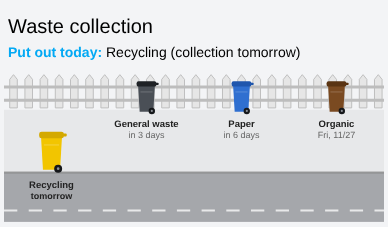

# Waste Street Card

Your waste collection calendar as a little street scene: bins wait behind the fence, the bin that is due **rolls out to the kerb** the day before, and on collection day the truck drives by.



- The **next collection is always on the left**.
- Works with **any calendar entity**: [Waste Collection Schedule](https://github.com/mampfes/hacs_waste_collection_schedule), an ICS calendar, or a local calendar.
- Headline in plain words: “Put out today: Paper (collection tomorrow)”.
- Bin types and colours are configurable; English and German texts.

## Installation

**HACS:** HACS → ⋮ → *Custom repositories* → add this repository with type *Dashboard* → install → reload the browser.
**Manual:** copy `waste-street-card.js` to `config/www/` and add `/local/waste-street-card.js` as a JavaScript module resource.

## Options

| Option | Description |
|---|---|
| `entity` | Calendar entity (required) |
| `title` | Card title (`''` hides it) |
| `days` | How many days to look ahead (default 60) |
| `exclude` | Bin types to hide, e.g. `[bio]` |
| `types` | Own bin list, see below |

Default bin types (the `match` is a case-insensitive regular expression tested against the event title):

| key | matches | colour |
|---|---|---|
| `bio` | bio, organic, compost, garden | brown |
| `paper` | papier, paper, pappe, cardboard | blue |
| `recycling` | gelb, wertstoff, verpackung, recycl, packaging, plastic | yellow |
| `residual` | rest, general, residual, landfill, refuse | grey |

```yaml
type: custom:waste-street-card
entity: calendar.waste_collection
exclude: [bio]
```

Own types:

```yaml
types:
  - {label: Glass, match: 'glass|glas', body: '#2e8b57', lid: '#1f6b40'}
  - {label: Paper, match: paper, body: '#2f6fd0', lid: '#1f56ad'}
```

## Deutsch

Der Abfallkalender als Straßenszene: Die fällige Tonne rollt am Vortag an den Bordstein, am Abholtag fährt das Müllauto vorbei. Die nächste Tonne steht immer links. Funktioniert mit jedem Kalender, z. B. *Waste Collection Schedule*.

## License

MIT – see [LICENSE](LICENSE).
